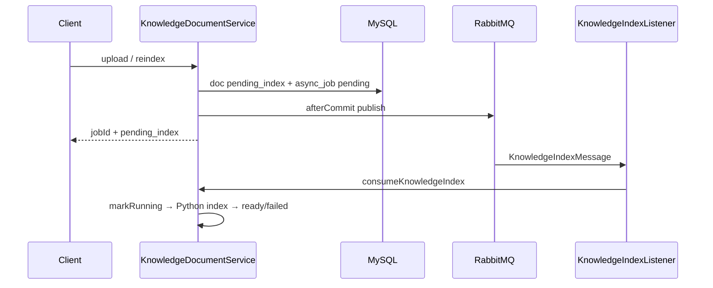

# MQ 知识库文档索引异步化（Wave E-B3）

> 2026-11 · AI Creative Workbench · 面试向开发复盘  
> Roadmap：Phase 4 · Wave E-B3（依赖 E-B0）

## 1. 背景与目标

**用户痛点**

- 上传 / 全库 reindex 在 HTTP 线程里同步调 Python，大 PDF 易超时，前端长时间 loading。
- 进程内 `CompletableFuture` / 线程池在重启后丢任务，无法追溯状态。
- 列表轮询粗暴刷新导致表格闪烁；单文档进度条无法反映批次上传真实进度。

**目标**

1. 上传与 reindex 快速返回；向量索引在后台 Worker 执行。
2. `async_job` + `knowledge_document.index_status` 作为可查询状态机。
3. 前端静默轮询 + 本批「已成功索引 M/N」进度条，切模块可恢复（sessionStorage）。

---

## 2. 方案选型

| 决策点 | 选型 | 理由 |
|--------|------|------|
| 异步载体 | RabbitMQ + 同 JVM `@RabbitListener` | 学习成本可控；与后续 B4 抠图任务共用 Exchange |
| 任务表 | MySQL `async_job` | 用户可查 job、Admin 可扩展任务中心 |
| 前端进度真相源 | 列表 `indexStatus`（非逐 job 轮询） | 与分页列表一致；批次维度用本批 `documentId` 集合 |
| 无 Rabbit 时 | `app.rabbit.enabled=false` 走同步 index | 本地 / CI 不强制中间件 |
| reindex / reindex-all | 与上传共用 `knowledge.index` 队列 | Worker 一律读盘索引；job `type` 区分审计 |

**放弃的方案**

- 仅 HTTP 202 + 内存任务表：重启丢状态，面试难讲可靠性。
- 前端只轮询 `GET /jobs/{id}`：多文件上传 N 次请求，与列表 UI 脱节。

---

## 3. 关键实现

### 3.1 数据流

### 3.2 核心逻辑

- **入队**：`enqueueIndexJob` — 创建 `document_index` 或 `reindex` 类型 job，置 `pending_index`，事务提交后 `publishIndexMessageAfterCommit`。
- **消费**：`consumeKnowledgeIndex` — `LoginUserContext` 手动 set/clear；`markRunning` 仅 pending/failed 可 claim；失败 rethrow 便于消息重投。
- **前端**：`useKnowledgeIndexPolling`（有活跃索引才静默刷新 + diff）；`uploadBatchIds` + `sessionStorage`；进度 = 本批 `ready` 数 / 本批总数。
- **Admin 全库**：`asyncEnqueue=true` 时 `succeeded` 为入队数，文案引导去文档库看进度。

---

## 4. 踩坑与思考

| 现象 | 根因 | 尝试 / 思考 | 最终解法 |
|------|------|-------------|----------|
| 进度条长期 0/1、0% | 用当前页单个 pending 文档当分母 | 改批次 id | 上传回调收集全部 `uploadedDocumentIds` |
| 切模块进度条消失 | 组件卸载丢失 state | localStorage 过重 | `sessionStorage` 恢复本批 id |
| 列表不停 Spin | 轮询 deps 绑整个 `records` | 拉长间隔仍闪 | `hasActiveIndex` + silent fetch + 快照 diff |
| Worker 查不到文档 | MQ 早于事务 commit | 立刻 publish | `TransactionSynchronization.afterCommit` |
| 重复消费双份索引 | 无状态机 | — | `markRunning` 幂等 + succeeded/running 直接 skip |
| 归属校验写错 | `userId != null \|\| path blank` | 代码评审 | 改为 `userId != null && !userId.equals` |

---

## 5. 验收清单

**自动化（CI / 本地）**

- [x] `mvn test` 含 `AsyncJobServiceTest`（markRunning 幂等）
- [x] `pnpm -C frontend run build`

**手工（建议本机 middleware profile）**

- [ ] 多文件上传 → 「本次上传：已成功索引 M/N」→ 全 `ready` 后进度条约 2.5s 消失
- [ ] 索引中切到其他模块再回文档库，进度条仍在
- [ ] 索引中重启 backend，任务最终 `ready` 或 `index_failed`（Rabbit 未 ACK 会重投）
- [ ] Admin「重建全库向量」→ 提示已提交后台任务，文档库多条「索引中」
- [ ] `app.rabbit.enabled=false`：上传 / reindex 仍为同步，行为与 Wave D 一致

---

## 6. 面试话术（STAR）

- **上传异步化**：知识库上传原先阻塞 HTTP 调 Python 做向量化；我引入 `async_job` 和 RabbitMQ，上传事务内写 MySQL 后 afterCommit 发消息，Worker 抢任务并调 Python；HTTP 立刻返回 `pending_index`，前端按列表状态静默轮询，避免超时和长时间 loading。
- **可靠性 / 幂等**：消费前用 `markRunning` 把 job 从 pending/failed 迁到 running，已成功或进行中的 job 直接跳过，防止重复投递打坏索引；失败抛出让 Spring AMQP 不 ACK，消息可重投，failed 状态可再次 claim。
- **体验优化**：进度条按「本批上传 documentId」算成功数，并用 sessionStorage 在路由切换后恢复；轮询仅在存在 `pending_index/indexing` 时触发，列表无变化不 setState，解决表格闪烁。

---

## 7. 关键文件

| 文件 | 作用 |
|------|------|
| `backend-java/.../service/KnowledgeDocumentService.java` | 上传/reindex 入队、`consumeKnowledgeIndex` |
| `backend-java/.../service/AsyncJobService.java` | job 生命周期 |
| `backend-java/.../service/mq/KnowledgeIndexListener.java` | 消费者 |
| `backend-java/.../config/RabbitMqConfig.java` | Exchange / Queue / JSON 转换 |
| `frontend/src/hooks/useKnowledgeIndexPolling.ts` | 静默轮询 |
| `frontend/src/utils/knowledgeUploadBatchStorage.ts` | 批次 id 持久化 |
| `frontend/src/pages/KnowledgeDocumentListPage.tsx` | 进度条与列表 |
| `docs/sql/async_job.sql` | 任务表 |

---

## 8. 后续演进（未做）

- 消息 `deliveryMode=PERSISTENT`、死信队列 DLQ
- 统一任务中心页（E-B5）
- `GET /jobs` 批量查询（当前 UI 以 document 状态为主）
